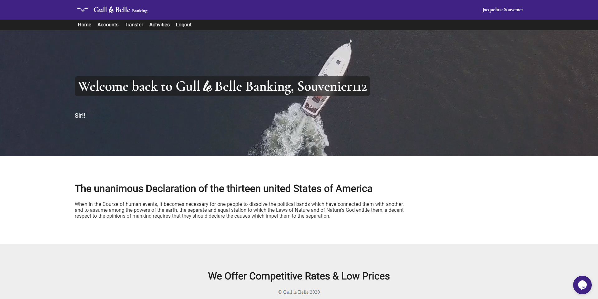
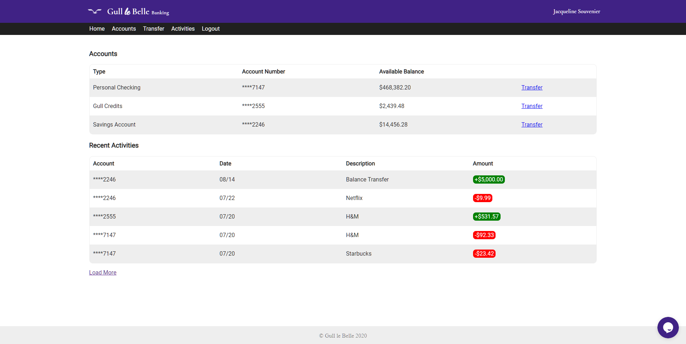
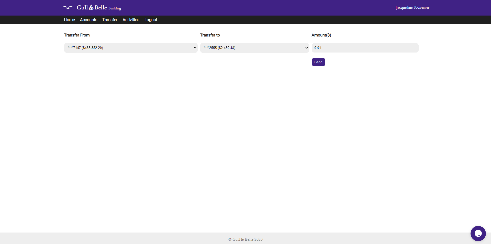
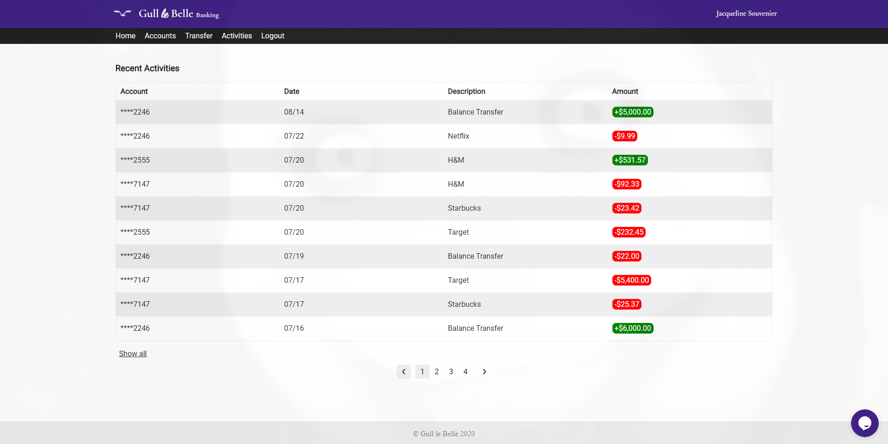

# Documentation
## About
A fake banking website for scambaiting copied as close to Kitboga's , "Gull and Bull", as possible.

This is a role-play (RP) fork of the original project, adapted for fictional in-character use.

## Disclaimer
This fictional role-play project is intended for local scambaiting and personal use only. Do not present it as a real financial institution or collect real financial information.

## Features
* Fake bank account sign up
* Transfer between accounts
* Disabled inspect on account information page (still accessible through other pages)
* Session inactivity timeout (15 minutes)
* Recent activities
* Creepy face show up from time to time

## Features to add
* External account transfer
* Any other features I can think of

## Screenshots
### Home page

### Logged in home page

### Account page

### Transfer page

### Activities page


## How to setup
### Requirements
- Docker Desktop (or Docker Engine) with Docker Compose.

### Start the site
1. Clone or download this repository.
2. From the repository folder, run:
   ```
   docker compose up --build
   ```
3. Open [http://localhost:8080](http://localhost:8080).

Compose builds the PHP/Apache image, starts MariaDB, and creates the `users` table automatically on the database's first start. Each user has one account identified by their unique 17-digit SteamID64, with a starting balance of $500. Existing users can add their SteamID from their profile page. To run the containers in the background, use `docker compose up --build -d`.

The database is stored in the `db-data` Docker volume. Legacy activity JSON files remain in `account-data` after import as a backup. To stop the site, run `docker compose down`. **Do not run `docker compose down -v` unless you intend to delete the database and legacy activity files.**

The default database credentials in `docker-compose.yml` are for local development only. You can override `DB_USER`, `DB_PASSWORD`, and `DB_ROOT_PASSWORD` with environment variables before starting Compose.

Signup, login, transfers, profile-ID changes, and balance changes each have a separate placeholder for future external PostgreSQL synchronization in `includes/external-db-sync.inc.php`: `syncExternalUserOnSignup()`, `syncExternalUserOnLogin()`, `syncExternalTransfer()`, `syncExternalAccountInfoUpdate()`, and `syncExternalAccountBalanceUpdate()`. They currently return `null` and make no network calls, so the existing local database flows remain authoritative.

Account activity records are timestamped in the database when created. Both sides of a transfer receive their own timestamped activity entry, and activity tables display the date and time.

## Updating
Rebuild and restart the containers after updating the source:
```
docker compose up --build -d
```
The `db-data` and `account-data` volumes are preserved.

When updating an existing database after a schema change, apply its migration once. For the SteamID and Discord ID signup fields, run:
```
docker compose exec -T db sh -c 'mariadb -uroot -p"$MARIADB_ROOT_PASSWORD" "$MARIADB_DATABASE"' < docker/migrations/001_add_signup_platform_ids.sql
```
The migration is safe to run more than once.

To convert an existing database to one SteamID-numbered account per user, run:
```
docker compose exec -T db sh -c 'mariadb -uroot -p"$MARIADB_ROOT_PASSWORD" "$MARIADB_DATABASE"' < docker/migrations/002_single_steamid_accounts.sql
```
This resets every existing account balance to $500. Existing users without a SteamID can add it from their profile before making transfers. Transfers are sent to another user's SteamID64.

To move activity history into the database, first create the activity table and then import the existing JSON files:
```
docker compose exec -T db sh -c 'mariadb -uroot -p"$MARIADB_ROOT_PASSWORD" "$MARIADB_DATABASE"' < docker/migrations/003_create_account_activities.sql
docker compose exec web php /var/www/html/docker/migrations/import_legacy_activities.php
```
The import can be rerun safely. New signups and transfers write activity records directly to the database. The account page shows the five newest entries; the Activities page shows the 15 newest entries.
## How to use

### Sign up
Click on `join us` on the website and fill in the form to sign up.
New accounts start with a $500 balance. Each user has one account identified by their SteamID64.
### Transaction history
Recent activities are stored in the `account_activities` database table.
### Painful load
Moved to [Painful_Load](https://github.com/lahrence/Painful-Load).

### Optional archives
The `Search_Spoof` extension and `Gull-le-Belle-records` archive are not included in this public fork.

## Extra
The site is available only on the local computer at [http://localhost:8080](http://localhost:8080).

## Experimental Features and Details
* **Download button** When enabled (by going into 'setup.json' and changing `downloadButton` to true), users can have a custom button that, when clicked, downloads a file of their choosing.
* **setup.json** setup.json is a new JSON file used to enable/disable editable features (very short list at the moment).
